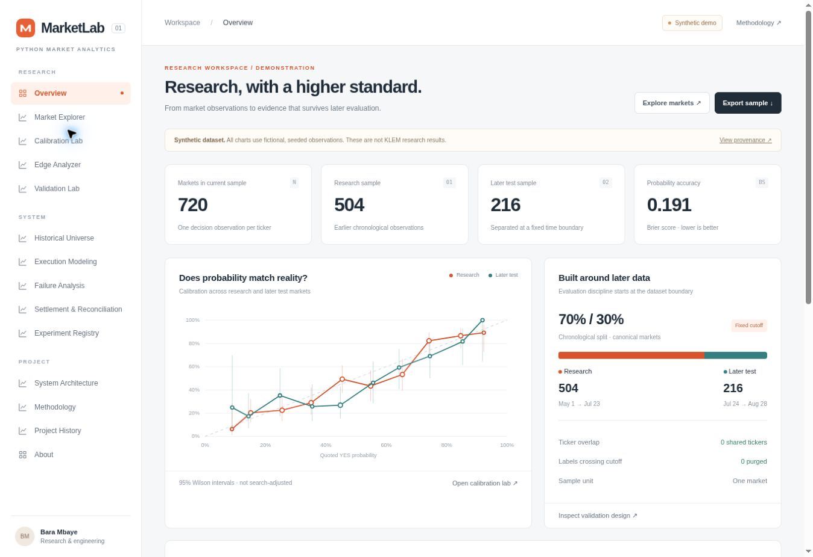
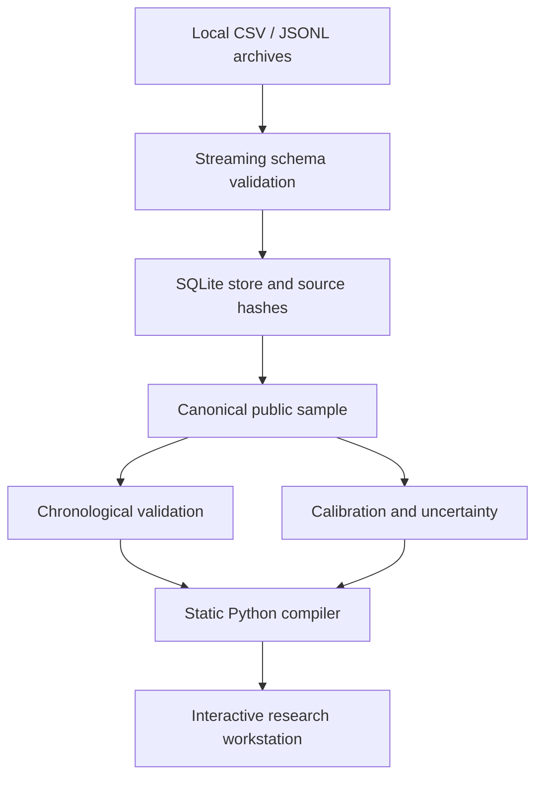

# Python Market Analytics Research Platform

**An inspectable research workstation for market data, chronological validation and execution-aware analysis.**

**Live demo:** deploy from this repository with the included GitHub Pages workflow; no public URL has been published for this release. **Instant preview:** open [`dist/index.html`](dist/index.html) after downloading the repository.



**Python 3.11+ · SQLite · JavaScript · SVG · GitHub Pages · zero runtime dependencies**

MarketLab turns a market-research workflow into a usable analytical product. It joins a reproducible Python data pipeline to a custom research interface: inspect individual observations, compare probability calibration, interrogate features across time, test execution-cost assumptions, and surface settlement inconsistencies.

## Evidence status

This release includes **720 fictional markets** generated with a fixed seed: **504 earlier research observations and 216 later test observations**. Every data page labels the demonstration. These are software fixtures, not historical Kalshi outcomes, KLEM performance or investment results.

The supplied source material comprised a project brief and three Windows folder-listing screenshots. They established intended scope and artifact names, not actual data schemas, implementation behavior or research results. The KLEM historical figures remain in an explicitly **unverified claim register**, separate from the app's computed metrics. No real research output was supplied or silently reconstructed.

## Why this exists

Historical patterns are easy to find and hard to trust. A credible research workflow needs a coherent dataset, decision-time features, later evaluation, uncertainty, execution assumptions, and a path back to the original evidence.

The broader project brief describes KLEM research into Kalshi Bitcoin markets. This public implementation translates that research discipline into an inspectable product while keeping raw archives and private execution systems outside the repository.

## Explore the product

| Workspace | Working behavior |
| --- | --- |
| Overview | Computed sample metrics, comparative calibration, fixed split and lifecycle |
| Market Explorer | Period/date/side/ticker filters, pagination, record inspection, CSV export |
| Calibration Lab | Adjustable probability buckets, expected vs. observed YES outcomes, Wilson intervals |
| Edge Analyzer | Eight allowlisted features, preset buckets, research/test comparison, pairwise tables |
| Validation Lab | Purged chronological split, four expanding windows, seeded block bootstrap, cost sensitivity |
| Historical Universe | Import architecture, current coverage, unverified source-claim register |
| Execution Modeling | Interactive fees, slippage and independent fill-rate scenarios |
| Failure Analysis | Loss regimes and streak distributions in the filtered chronological sample |
| Settlement & Reconciliation | Computed statuses for fictional matched, mismatched, pending, missing and duplicate records |
| Experiment Registry | Local exploration snapshots with dataset hash, filters and JSON export |
| Architecture / Methodology / History / About | Explicit implementation boundaries, definitions and source provenance |

**Deliberate limits:** no live orders, exchange API integration, actual fill replay, reconstructed historical paths, latency simulation, strategy fitting, or automatic persistence verdicts. Those require source artifacts that were not attached. The architecture page separates shipped components from the broader KLEM concepts.

## Run locally

From the extracted repository directory:

```bash
python -m marketlab build
python -m http.server 8000 --directory dist
```

Open **http://localhost:8000**. No pip install, Node build, API key or account is required. On Windows, `py` can replace `python`.

For a quick offline preview, open `dist/index.html` directly. Browser-local storage behavior for file URLs varies; use the local HTTP server for persistent exploration records.

```bash
python -m unittest discover -s tests -v
node --test tests/analytics.test.cjs
```

Node 20+ is used only for optional browser-calculation tests and CI, not to run the application. Regenerate the fictional fixture with `python -m marketlab demo`.

## Bring in actual research later

Keep giant archives outside this repository. The importer reads JSONL or CSV incrementally into a local SQLite store, exports an allowlisted public sample, and compiles the UI from that small file.

```bash
python -m marketlab ingest /path/to/archive.jsonl --mapping research/mapping.example.json
python -m marketlab export --limit 5000 --output data/public/imported.json
python -m marketlab build --input data/public/imported.json
```

**The mapping example is a contract, not a verified KLEM adapter.** Inspect your real keys and units first. It maps canonical field names to flat source keys; it does not infer cents vs. fractions, reverse NO probabilities, reconstruct features, or join settlement labels. Nested event formats need a local adapter before ingestion. See [the import guide](docs/IMPORT_REAL_DATA.md).

For repeatable builds and GitHub Actions, set `research/build-config.json` to:

```json
{"dataset":"data/public/imported.json"}
```

Inspect the sanitized output before committing. Even decision-time market features can reveal private parameter choices. This exporter removes unknown fields; it cannot decide whether a particular market feature is proprietary.

## Research design

- **Unit of analysis:** the earliest valid observation per ticker. This avoids treating repeated snapshots as independent markets.
- **Time boundary:** the earlier 70% of canonical decisions form the research side. Equal decision timestamps stay together. Research labels not settled before the first test decision are purged.
- **Calibration:** mean quoted YES probability versus observed YES frequency; 95% Wilson intervals, with small samples explicitly identified.
- **Chronological diagnostics:** four expanding research windows and nonoverlapping later windows, with settlement-aware training-label purges. No model is fitted in these diagnostics.
- **Uncertainty:** a deterministic moving-block bootstrap of later-test gross contract returns, using 1,000 resamples and up to 12 consecutive markets per block.
- **Execution:** additive fee and adverse-slippage scenarios, with a uniform independent fill assumption. A slipped entry at or above $1 is unfillable.
- **Leakage controls:** explicit feature allowlist; outcome and realized-return fields cannot become explanatory features in the UI. Actual upstream features still need an as-of audit.

Once a later period has been inspected, it is retrospective evidence. Confirmation requires frozen rules and a new untouched period. These intervals are not adjusted for search over many features and cannot establish an edge by themselves.

## Architecture



The private archive and SQLite store remain local. Python compiles the public sample and auditable analytical outputs. JavaScript recalculates filtered views without network access. Tests compare browser statistics against the Python build. Static hosting keeps the public deployment simple and inexpensive.

## Engineering decisions and findings

**Streaming before presentation.** JSONL processing holds one bounded record at a time. SQLite provides disk-backed identity checks and grouping. Public export holds at most 10,000 canonical records in Python; default export is 5,000.

**Explicit semantics before convenience.** Probabilities must be fractions and must represent YES; outcomes must be official YES results. The selected side changes payoff, not the calibration target. Bad units, nonfinite values, naive timestamps, implausible TTX and conflicting settlements are rejected.

**A clear evidence boundary.** User-supplied figures do not become verified metrics simply because they appear in a brief. Source hashes, sample labels, fixed rules, and an unverified register keep the story inspectable.

**No substantive market finding is claimed in this release.** The fictional dataset exercises the tooling. Real conclusions require source data and rerunning the documented validation.

## Repository layout

```text
marketlab/          Python schema, streaming import, statistics, compiler and CLI
web/                Responsive interface and pure JavaScript analytics
research/           Build configuration, mapping contract, unverified claims
 data/public/       Small deterministic demonstration input
 dist/              Ready-to-open static application (generated)
 tests/             Python regressions and Node analytics parity tests
 screenshots/       Captured application views
 docs/              Import, deployment, architecture, case study and audits
 .github/workflows/ CI and explicit GitHub Pages deployment
```

`data/private/`, credentials, signing keys, account state, raw archives and live logs are ignored and must remain uncommitted. See [SECURITY.md](SECURITY.md) and [the audit](docs/AUDIT.md).

## Deployment

Follow [DEPLOYMENT.md](docs/DEPLOYMENT.md). Upload the **contents of the extracted project folder**, including `.github/workflows`, then select GitHub Actions as the Pages source and run the **Deploy MarketLab** workflow. The workflow validates and rebuilds the application before deploying.

This is a custom static application, not Streamlit. It will not automatically replace an existing Streamlit deployment. No existing GitHub repository was modified for this handoff.

## Lessons and limitations

The build demonstrates why research interfaces need dataset identity, temporal boundaries, uncertainty and explicit implementation scope. A smooth UI cannot turn unverified source material into evidence. The strongest next increment is to map one sanitized real dataset, verify its feature timestamps, and attach the specific report behind each historical claim.

Evenly spaced exports preserve time coverage but are not full-universe statistical estimates. Markets may be serially dependent. Constant execution assumptions omit queue dynamics and adverse selection. Source-feature definitions must be reconciled across versions. See [the methodology](docs/METHODOLOGY.md) for the full boundaries.

[Technical case study](docs/CASE_STUDY.md) · [Recruiter and LinkedIn descriptions](docs/PROJECT_DESCRIPTIONS.md) · [Source evidence audit](docs/SOURCE_EVIDENCE.md)

MIT license for the newly created code. Rights to any future imported data or existing KLEM source remain with their respective owners.
